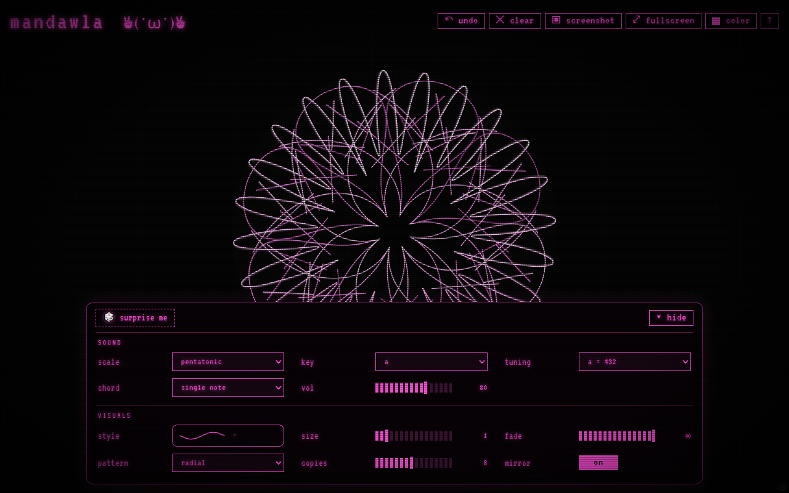

# mandawla ✌︎('ω')✌︎

Drag anywhere on the screen. Every stroke is mirrored into a symmetric pattern, and its distance from the centre sets the note

**Try it: [nokitri.github.io/mandawla](https://nokitri.github.io/mandawla/)**

